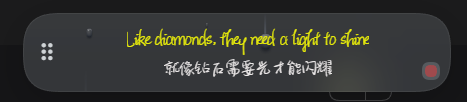
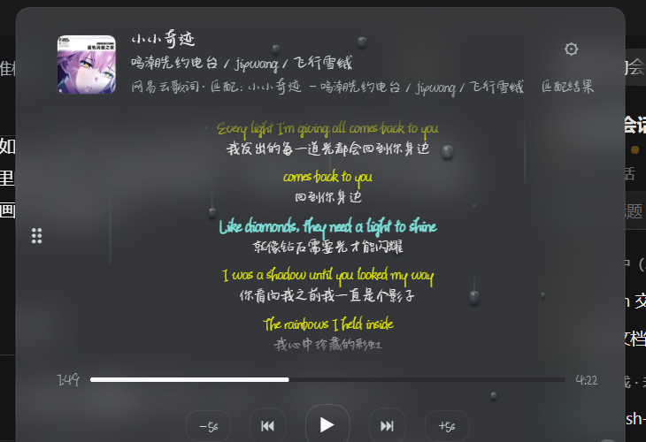
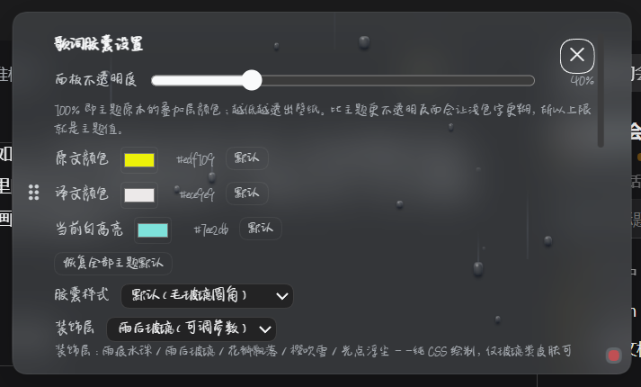
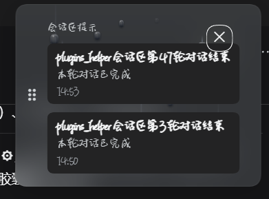

# dsh-netease-lyrics

[](CHANGELOG.md)
[](LICENSE)
[](#前置条件)

一个给 DeepSeek Harness 用的歌词插件：从 Windows **SMTC**（系统媒体控件）读出当前播放的歌，
按「标题 + 歌手 + 时长」去网易云、QQ 音乐、酷狗、咪咕依次找词，画成页面顶部的一枚胶囊。
不登录、不访问账号数据，任何向 SMTC 注册媒体会话的播放器都能当来源——包括你根本没为它
装过歌词插件的那几个。（唯一的例外是 bilibili 字幕，见[那节](#bilibili-视频字幕)。）

胶囊回答「现在唱到哪一句」，展开后是封面、滚动歌词窗口、进度条和五个播放控制
（`后退 5 秒` / `上一首` / `播放暂停` / `下一首` / `前进 5 秒`）。没有媒体会话时整块隐藏，
不占位、不抢焦点。另有一个环境悬浮歌词层（测试中），把歌词句随机浮现在面板左右两侧。

```
SMTC ──► powershell.exe 5.1 桥 ──► 宿主半边 ──► 浏览器半边
        (lib/smtc-bridge.ps1)      (lib/index.js)    (lib/client.js)
```



**Contents:** [为什么](#为什么) · [前置条件](#前置条件) · [安装](#安装) · [工作方式](#工作方式) ·
[胶囊](#胶囊) · [会话区提示](#会话区提示) · [歌词源](#歌词源) · [配置](#配置) ·
[故障排查](#故障排查) · [已知边界](#已知边界) · [开发与测试](#开发与测试) · [来源与许可](#来源与许可)

## 为什么

DSH 的界面上没有任何地方知道你在听什么。系统媒体控件（SMTC）是唯一的公共接口，但它只给
App、标题、歌手、专辑、播放状态与位置——**没有歌曲 ID**，所以要拿到歌词，还得自己再去各家的
曲库里按「标题 + 歌手 + 时长」把歌找回来。

网易云桌面版的 SMTC 支持是**较新版本才有的**：设置 →「系统」→ 勾选「开启 SMTC（开启后播放
信息同步到系统菜单栏及壁纸等第三方软件）」。老版本客户端不注册 SMTC 会话，那需要 BetterNCM +
[InfLink-rs](https://github.com/yezisorft/dsh-netease-island) 把播放状态发布到系统媒体控件。

这个插件做了三件取舍：

- **不求人**：播放器客户端不承担歌词接口服务，不要求它们为了取词而启动。四个歌词源都是
  公开搜索/歌词接口，插件自己按「标题 + 歌手 + 时长」打分匹配。
- **多源是保险，不是换源**：媒体自己的提供方先试，失败才依次后退。四家全失败时读本机
  `.lrc` 侧车与音频内嵌标签，还不成就不显示——而不是显示别人的歌词。
- **零运行时依赖**：`dependencies` 为空，只 `peerDependencies` 了 `@deepseek-ai/cordis` 与
  `react`（宿主本来就有）。没有打包器、没有 CDN、没有额外的常驻进程；宿主半边就是一个路由
  加一个 PowerShell 子进程。

## 前置条件

| 项目 | 要求 |
| --- | --- |
| 宿主 | DSH `>=0.1.5-rc.1`（`package.json` 的 `engines` 里有这一条）；Node `>=18` |
| 系统 | Windows 10 / 11（桥进程依赖 WinRT `Windows.Media.Control`） |
| PowerShell | Windows PowerShell 5.1（`powershell.exe`，系统自带）。不能用 pwsh 7，原因见下 |
| 播放器 | 任何向 SMTC 注册媒体会话的播放器 |
| 网易云桌面版 | 新版在设置 →「系统」里勾选**开启 SMTC** 即可；老版本不注册 SMTC，需 BetterNCM + InfLink-rs，或改用浏览器网页版播放 |
| bilibili 字幕（可选） | 需要装本仓库的浏览器扩展才能拿到 BV 号，见[bilibili 视频字幕](#bilibili-视频字幕) |
| 网络 | 宿主进程可访问网易云、QQ、酷狗、咪咕的搜索与歌词接口，以及搜索结果返回的歌词 CDN |

**为什么必须是 `powershell.exe` 而不是 pwsh。** 桥脚本靠 WinRT 投影读
`Windows.Media.Control`，用 `Add-Type -AssemblyName System.Runtime.WindowsRuntime` 拿
`AsTask()` 把 WinRT 的 `IAsyncOperation` 转成能 await 的 Task（`lib/smtc-bridge.ps1:72-99`）。
PowerShell 7 是 .NET Core，没有这个程序集，WinRT 互操作在 PowerShell 7 上早期就被移除了。
宿主这边是主动规避的：`resolvePowershell()`（`lib/index.js:241-248`）优先直接拼
`%SystemRoot%\System32\WindowsPowerShell\v1.0\powershell.exe` 绝对路径，所以即使你的 PATH 上
pwsh 排在前面也不会被选中。你不需要装任何额外的东西，5.1 是 Windows 自带的。

## 安装

```powershell
git clone https://github.com/Mostimadesi/dsh-netease-lyrics.git
dsh plugin --profile desktop add <克隆目录的绝对路径>
```

或让 DSH 插件工程会话用 `plugin_manager install_bundle` 安装。装完**重启 DeepSeek Harness**——
客户端注入表只在宿主启动时采集一次。之后从 `dev` 分支更新代码时不用再重启，见
[改完代码什么时候要重启](#改完代码什么时候要重启)。

## 工作方式

```
网易云 ──SMTC──► powershell.exe 5.1 桥(lib/smtc-bridge.ps1) ──行JSON──► 宿主半边
宿主半边(lib/index.js)：桥守护 + 歌曲指纹变化 → 搜索/匹配/拉词/缓存(lib/lyric-service.js)
  另订阅全局 session/event 事件流 → 工作区通知折叠(lib/notice-aggregate.js)
  GET  /dsh-netease-lyrics/state.json   状态 + 匹配结果 + 歌词行 + notice 通知
  GET  /dsh-netease-lyrics/cover.png    封面（按 ?v=<serial> 不可变缓存）
  POST /dsh-netease-lyrics/rematch      清掉当前曲目的匹配结论并重试（仅回环）
  POST /dsh-netease-lyrics/notice/ack   查看后消费轮次结束类通知（提问保留）
                                        body {} 全量消费；{"sessionIds":[...]} 定向消费
浏览器半边(lib/client.js)：shell.overlay 注册浮层，单次轮询 + 进度外推
```

播放状态全部来自 SMTC：标题、歌手、专辑、播放/暂停、位置、时长。SMTC **不含歌曲 ID**，
所以匹配只能靠歌名、歌手和时长——这决定了下面这套打分。

### 匹配打分

时长差（≤2s +3 / ≤5s +2 / ≤10s +1 / >10s −2）+ 标题（完全一致 +4 / 包含 +2）+ 歌手重合（+2）；
接受阈值：总分 ≥4 且标题分 ≥2。

同名翻唱、Live 版、不同录音版本仍可能错配。展开态会显示**匹配到的曲目名**，旁边一个
「重新匹配」；错配不是静默的。

### 缓存与限流

`~/.dsh/dsh-netease-lyrics-cache.json`（v2，最多 300 项，记录歌曲版本、时长与歌词来源）。
成功结果保留 15 天；在线源「未匹配」结论保留 10 分钟，请求故障保留 30 秒。旧 v1 缓存不迁移，
以免旧单源失败阻断新回退。请求逐请求至少间隔 800ms；快速切歌会取消旧曲的请求与排队工作。

## 胶囊



收起态只有一行歌词（有译文时下方一行小字）。悬停或点击展开，高度变化由
`grid-template-rows: 0fr → 1fr` 承担——插值的是子元素的**固有高度**，所以歌词行数多少都不用
测量，也不会有「展开时高度跳一下」的观感。

歌词窗口固定 9 行，当前句高亮并随播放逐行滚动；鼠标移开后有 420ms 宽限，避免误收。
收起时 `.dnl-now-wrap` 高度归零、`width: 0` 仍参与布局，所以两个状态之间不会有宽度突变。

**播放控制**走 `POST /dsh-netease-lyrics/control`，只允许 loopback 且只接受白名单命令。
`canToggle` / `canNext` / `canPrev` 为 false 时对应按钮直接禁用——灰掉，而不是点了没反应。
`±5 秒` 跳转在进度条上做，不写回播放器（酷狗这种不报位置的就整体禁用）。

**进度外推**：轮询间隔 500ms（`pollMs`），两次采样之间按速率外推，最多外推 2 秒。桥 2.2 秒
不更新时 `timelineRefreshes` 自增，说明读到的是旧数据而不是歌停了。

### 胶囊内置设置



点面板右上角的 ⚙（展开后齿轮变 ✕ 才是设置视图）。原本散在插件设置页的胶囊选项搬到了这里，
调的时候能直接看效果：

- **面板不透明度**（20–100%）：上限就是主题原本的叠加层颜色。比主题更不透明反而会让浅色字更糊。
- **颜色**：原声颜色、译文颜色、当前句高亮，各有「默认」按钮与一个「恢复全部主题默认」。
- **胶囊样式**与**装饰层**：见下节。
- **歌词偏移校准**：±0.1s / ±0.5s / 归零，按曲记住。
- **呼吸灯**：跟随主题 / 跟随封面 / 仅通知到达时 / 关闭四档；前两档可选呼吸节奏（舒缓 8.4s、
  标准 5.6s、活跃 3.9s），「仅通知到达时」可选通知光晕形态（贴边描边 / 收敛光晕）。
- **音波环**（默认关闭）：点阵环 / 星尘环 / 波形描边三款，可调范围（仅收起态或收起+展开）、
  亮度（含蓄 / 鲜明）、律动源（歌词拍格 / 音频 FFT）与律动强度（0–200）。
- **字体**与**收起态显示比例**（0–100%）。

左侧的 ⠿ 是拖拽手柄，默认落在视口宽度的 70% 处。拖过之后位置写进偏好，换页仍然在你放的地方。

### 皮肤与装饰层

七种皮肤：`默认`（毛玻璃圆角）、`渐变玻璃`（双色渐变描边 + 斜向罩染 + 胶片颗粒，四个旋钮可调）、
`静谧祝愿`（紫蓝柔光）、`暗夜余烬`（暖光炭色）、`方舟观测`（HUD 切角 + 四角框角 + 等高线 +
扫描线）、`月相引路`（深蓝渐变 + 内发光 + 月相弧光 + 漂浮光点）、`实底卡片`。

<p>


</p>

装饰层（仅玻璃类皮肤可用）：**雨痕水珠**、**雨后玻璃**、**花瓣飘落**、**樱吹雪**、**光点浮尘**。
全部纯 CSS 程序化绘制，无素材文件，位于文字下层，`prefers-reduced-motion` 下静止。

### 换句过渡

换句时十字淡入淡出 340ms；呼吸灯是四层叠加：2px 亮线、5px 中间层、9px 外层泛光，
再加一层 `hue-rotate(18deg)` 的漂移层。节奏随歌曲速度自适应（8.4 / 5.6 / 3.9 秒三档），
换句瞬间有一次 0.9 秒的外扩。快歌不至于跟不上，慢歌也不会闪。

### 音波环

默认关闭，在胶囊设置里逐项打开。三款外观：**点阵环**（圆点沿描边绕行）、**星尘环**（更密的点
+ 明暗呼吸）、**波形描边**。律动来自两个源：**歌词拍格**（用当前句的起唱时刻与逐字进度算拍，
不需要音频数据，默认）与**音频 FFT**（实验：宿主侧 WASAPI 回环采样，经 `/beat.json` 下发一个
0–1 的标量；桥建不起来或掉线会如实报告，不会把「没声」当成「静音」）。可调范围（仅收起态 /
收起+展开）、亮度（含蓄 / 鲜明）、律动强度（0–200%，直接乘到 `--dnl-beat` 上）。

### 歌词偏移校准

歌词文件的时间轴和播放器的音频常常不是同一把尺（MV 版 vs 唱片版、别人压的侧车），
误差对整首歌是**常数**。校准只改「拿什么时刻去查当前句」：

```
lookupPos = clockPos − offsetMs/1000
```

**进度条、±5 秒跳转、SMTC 位置、歌词数据全部不动**，所以错的偏移最多高亮错一句，不可能污染
播放状态。方向：**「歌词太快」按 +**（整体提前），**「歌词太慢」按 −**（整体延后）。

按曲记住，键 = 归一化标题 + 歌手 + 秒级时长，存在浏览器 localStorage。键**不做** `(Live)`
去噪——这与匹配指纹刻意相反：现场版和录音室版时间轴不同，校准一个不能连带另一个。

### 失败原因面板

宿主一直在 `state.json` 里报告每个源的 `attempts[{source,status,reason}]`、`fallbackUsed`、
`score`、`service.policy` 与 `retry` 预算。展开胶囊 →「为什么」（仅失败时出现）：每个源一行
（命中 / 未命中的人类可读原因 / 请求失败的原始错误），外加策略顺序、重试预算、缓存条数。
成功时收起，切歌自动收起。标签表有测试**枚举宿主源码里的 reason 字面量**做漂移检查。

## 会话区提示



插件订阅宿主的**全会话事件流**（`session/event`，只读旁路，不影响任何会话），把每个工作区会话的
「提问」与「轮次结束」折叠成通知，经 `state.json` 的 `notice` 字段随轮询下发：

| 事件 | 提示 |
| --- | --- |
| `ask_user_question` 调用（含超时转 `pending` / 崩溃修复 `TOOL_OUTCOME_UNKNOWN` 后仍可回答） | xx会话区有提问 |
| 授权请求 `approval/asked`（未被即时决定） | xx会话区有提问 |
| `turn/end`（一轮对话结束；下一次 `turn/start` 使提示失效） | xx会话区第x轮对话结束 |

**无媒体**时胶囊直接显示提示语本身；多条带 `+n` 角标，最新提示交叉淡入，hover / 点击展开完整
列表。**播放中**则新通知先把折叠行暂时替换约 4 秒（与歌词行交叉淡入淡出），然后交还歌词行，
右下角亮起一个 8px 的静音红点，缓慢明暗呼吸；点红点展开列表，齿轮 ✕ 返回歌词。

悬停展开通知胶囊、点红点看完列表后移出鼠标，都算「已查看」，轮次结束类通知 260ms 淡出。
**悬停歌词行不消费通知**——读歌词不该静默吃掉一个没看过的提示。**提问类通知不被查看消费**，
回答后自然消失；轮次结束保留 10 分钟。

**切换到对应工作区即消隐**：读浏览器侧 sessions 服务的 `retainedBy.mainView` 信号（DSH 官方未读
标记同款判据），把当前主视图所在工作区的全部会话通知隐藏；进入工作区还会把该组**轮次结束通知**
定向消费（`POST /notice/ack` 带 `sessionIds`），**切走不再复活**。提问类永不被消费，离开后若仍未
回答则恢复提示。

**到达音效**：Web Audio 合成，无素材文件；四种样式（清脆双音 / 钟声 / 三音琶音 / 三连脉冲），
重放 1–3 次，音量 1–10 级，冷却 2.5s。刷新不重放，清除不播。浏览器自动播放策略拦截时首次可能
无声，任意点击后恢复。

细节约定：只统计**根会话**（带 `parentSession` 的子代理 / workflow 子会话不提示）；工作区名优先取
`workspaceRegistry` 显示名，回退目录名；每会话至多一条（提问优先），wire 上限 12 条；禁用插件清空
全部通知；`approval/asked` 与 `approval/decided` 在 never 策略下背靠背出现，极端情况下轮询间隙
可能闪现一瞬后自愈。

## 歌词源

### 回退顺序

**播放媒体自己的提供方先试**（网易云播放 → 网易云先试；QQ 音乐 → QQ 先试；酷狗 → 酷狗先试；
咪咕同理），然后依次 `网易云音乐 → QQ 音乐 → 酷狗音乐 → 咪咕音乐`。

媒体自身提供方**瞬时失败**（HTTP 错误 / 超时）会在当次解析内立即重试一次，避免一次抖动把整曲
让给其它源并被缓存钉死；搜索无候选的「自信 miss」不重试。最终结果来自非来源源、而来源源报错时
（如网易云 406 限流），**30 秒后自动失效缓存重解析**，每曲最多 2 次——首次命中的错源约半分钟内
自愈，无需手动。所有在线源都失败时读本机离线文件；全部失败返回 `unmatched`，其中有请求故障则返回
`error` 并保留各自原因，浮层不崩溃。

展开浮层会显示实际来源（「网易云歌词」「QQ 音乐歌词」「酷狗音乐歌词」「咪咕音乐歌词」「本地文件歌词」）。
`lyric.source` / `lyric.fallbackUsed` / `lyric.attempts` 分别表示实际来源、是否用过后备源、每个源的
尝试结果；`service.policy` 应为 `netease > qq > kugou > migu > local-file`。

三家播放器接入的具体约束：

- **QQ 音乐**：从 `20.22.2692.0613` 起内置 SMTC，无需注入 DLL。默认 `appPatterns` 含 `qqmusic`。
  本版不依赖 [QQMusic-ID-Injector](https://github.com/apoint123/QQMusic-ID-Injector)（它往流派字段
  塞 `QQ-{ID}`），仍按歌名/歌手/时长匹配，不同录音版本仍可能无词或错配。
- **酷狗**：标题、歌手、播放状态无需插件无需登录即可读；歌词走
  `songsearch.kugou.com/song_search_v2` → `krcs.kugou.com/search` → `lyrics.kugou.com/download`
  三段公开接口。**进度是估算的**——它的 SMTC 会话 `Position` / `EndTime` / `PlaybackRate` 全为 0、
  `canSeek` 为 false，插件按「曲目身份 + 播放状态」自己推进本地时钟，`positionEstimated` 标为
  `true`。代价：在酷狗里拖进度条不会被感知（想立刻对齐就暂停再继续）。桌面端自己的 `.krc` 是
  加密的（v20 已不是早年 `krc1` 的 XOR+deflate），插件不读也不解析它。
- **咪咕**：两次请求，不需要签名、登录或特殊 header。搜索响应每条自带 `lrcUrl`，直接返回纯
  UTF-8 LRC。几个实测约束：`pageSize` 被服务端忽略恒返 20 条；**必须硬性过滤歌手**（没收录时它
  会返回同名别人的歌）；`copyrightId` 含字母需按字符串处理；`duration` 是**秒**；LRC 是 CRLF、
  个别带 BOM；不要用 `search_all.do` 系列端点——它们没有 `duration` 字段，时长校验会静默失效。

### 译文的两种来源

| 形态 | 谁这样给 | 处理 |
| --- | --- | --- |
| 原文与译文是**两份独立文档** | 网易云（`lrc` + `tlyric`）、QQ（musicu `lyric` + `trans`） | 按时间戳配对（100ms 容差） |
| 原文与译文在**同一份文档**里，同时间戳或紧随其后 | 本地 `.lrc` 侧车、音频内嵌 LRC | `foldBilingualLines()` 折叠 |

第二条是 v0.4.27 修的：折叠之前 `parseLrc` 会把同戳的双语行保留成两行，而查表取「最后一条 ≤
当前位置」，于是**胶囊只显示译文、原文消失**。折叠规则：异语种续行 → `trans`；同语种续行 → 拼回
一句；完全相同的重复行 → 只留一条。线上四源不走这条逻辑。

QQ 的译文曾经一直为空：旧路径读 `fcg_query_lyric_new.fcg` 的 `trans` 字段，实测 8 首热门外文歌
**全为 0 行**。译文只存在于 musicu 网关的 `GetPlayLyricInfo`，且必须用 `crypt=0&qrc=0` 才返回明文
base64 LRC。现在一次 `POST u.y.qq.com/cgi-bin/musicu.fcg` 同时取回原文与译文；实测 12 首原文
12/12、带译文 9/12，时间戳 0.000s 对齐。`//`、`♪`、版权声明等占位行丢弃（实测 10 首里 35 行是 `//`）。
musicu 失败时回退旧 fcg 端点取原文（译文缺失但不丢歌词）。

### 逐字歌词（网易云 YRC）

请求多带一个 `yv=-1`（**同一个请求**，不增加请求数、不增加限流压力）。实测 10 首抽样 6 首有 YRC。
**普通歌词永远优先**，逐字只做一层附加：

- 行文本、行数、行时间**永不改变**；`words` 只挂到已能确信对齐的行上；
- 对齐**按文本而非按行号**——两份文档行数并不总相同（十年 48 vs 45，Live 版 92 vs 60），按序号
  仅 17/48 行对得上，按文本可达 38/48；重复副歌按「第 i 次出现对第 i 次」配对，Hello 实测覆盖
  52/53 行；
- 任何不确定（无 YRC、文本对不上、词时长非法、词越出本行窗口）一律**回退整行**；
- 渲染只改「已唱部分」的填充比例（`background-clip: text`），未唱部分是同色 40% alpha，
  **不是 transparent**（那会让半行歌词直接消失）；不支持 `color-mix` 的浏览器整条声明被丢弃，
  回退成普通歌词。

### 本地歌词兜底

三家在线源都失败时，按歌名 / 歌手匹配本机文件，再按优先级取词：

1. 音频文件旁的**同名 `.lrc`**（`Adele - Hello.mp3` → `Adele - Hello.lrc`）；
2. 音频**内嵌标签**：MP3 的 ID3v2 `USLT` / `TXXX:LYRICS` / `SYLT`，FLAC 的 `VORBIS_COMMENT`
   里的 `LYRICS` / `UNSYNCEDLYRICS` / `SYNCEDLYRICS`；
3. 只有普通文本没有时间戳时，按曲目时长**平均铺开**并标注「（无时间轴）」，不伪装成精确同步。

搜索范围默认 `%USERPROFILE%\Music` 与 `%USERPROFILE%\Downloads`，可用 `localDirs` 覆盖；扫描是异步
有界的（深度 2、最多 4000 个条目、1.2 秒预算），只在三家在线源都失败后触发一次。
`.krc`、`.m4a` 的 `©lyr`、APE/WMA 标签暂不支持。

### bilibili 视频字幕

**这一路要装浏览器扩展。** 系统媒体控件只给标题、歌手和位置，**没有 URL 也没有 BV 号**，
宿主无从知道你在看哪个视频；扩展负责把当前视频的 BV 号上报给本机插件。不装扩展时只剩
`bilibiliBvidOverride` 手填一个固定 bvid。

装法是「加载已解压的扩展程序」，不用上架商店：

1. 打开 `chrome://extensions`（Edge 是 `edge://extensions`），开启右上角的**开发者模式**；
2. 点**加载已解压的扩展程序**，选本仓库的 `browser-extension/` 目录；
3. 插件侧保持 `bilibiliEnabled: true`（默认开）。

扩展只上报 `{bvid, title, positionSec, durationSec, playing}` 这几项页面元数据到
`http://127.0.0.1:51789/dsh-netease-lyrics/browser-session`。**不访问 bilibili 接口、不读
cookie、不带任何登录凭证**，宿主不可达时静默失败（不影响你看视频）。上报存在内存里，15 秒
无心跳即过期，不落盘。端口跟 `browserSessionPort` 一致；改过端口就要同步改
`browser-extension/background.js` 顶部的 `DEFAULT_PORT`，再到扩展页点「重新加载」。

**字幕轨本身**还需要 `cookies.txt` 里的 `SESSDATA`（凭据只用于请求字幕接口，不上传、不写入
日志）。文件名优先 `cookies-bilibili.txt`，回退 `cookies.txt`；过期后静默回落音乐链。双语字幕轨
取「原文 + 译文」两轨合并。

没字幕时展开胶囊会写明原因（`no-bvid-report` 就是「浏览器扩展没上报 BV 号」）。

## 配置

给 profile 的 `cordis.patch.yml` 里本插件条目加 `config`：

```yaml
config:
  pollMs: 500                      # 轮询间隔，钳 200–5000
  appPatterns: cloudmusic,netease # SMTC appId 子串，仅 ASCII；留空回退默认
  apiBase: https://music.163.com   # 可指向自建 NeteaseCloudMusicApi
  showTranslation: true
  retryDelayMs: 15000              # 钳 5000–60000
  maxAutoRetries: 2                # 0 关闭；成功/切歌/手动重匹配即复位
  localLyrics: true
  localDirs: []                    # 默认 Music 与 Downloads，最多 8 个
  bilibiliEnabled: true
  bilibiliCookiePath: ''
  bilibiliBvidOverride: ''
  noticeTurnTtlMs: 600000          # 轮次结束提示的宿主保留上限，钳 60000–3600000
  browserSessionPort: 51789        # 仅绑 127.0.0.1，1024–65535
  browserSessionTtlMs: 10000       # 5000–60000
```

**首轮未匹配自动重试**：QQ 的 SMTC 会话可能早于曲库就绪，旧版被 10 分钟负缓存钉死。现在按
`retryDelayMs` 自动重试（重试前清负缓存确保真出网），每曲封顶 `maxAutoRetries` 次；`state.json`
的 `retry`（`attempts` / `pending` / `pendingAttempt`）可观测。

## 故障排查

先看 `state.json`：`GET http://127.0.0.1:<宿主端口>/dsh-netease-lyrics/state.json`
（本机 DSH Web 是 38471，端口以你实际打开的为准）。重点字段：

| 字段 | 看什么 |
| --- | --- |
| `bridge` | `down` / `starting` / `up` / `fatal`，配 `detail` |
| `matched` | 顶层字段，appId 是否命中 `appPatterns` |
| `sessionCount` | 恒为 0 说明播放器根本没注册 SMTC |
| `lyric.status` | `matched` / `unmatched` / `error`，配 `service.note` |

浮层不出现但 `state.json` 正常 → 看浏览器控制台 + `~/.dsh/dsh-netease-lyrics-boot.log`。

### 症状速查表

| 症状 | 先查什么 | 常见原因 |
| --- | --- | --- |
| 胶囊没出现 | 浏览器控制台 | 客户端脚本热替换读到写了一半的文件：语法错误 → 模块不注册，且无自愈。先刷新页面，再 `node --check lib/client.js` |
| 歌词一直「未匹配」 | `state.json` 的 `matched` | 播放器没注册 SMTC；appId 不在 `appPatterns`（网易云需在新版设置里勾「开启 SMTC」，老版装 BetterNCM + InfLink-rs） |
| 歌词一直「错误」 | `service.note` 或展开胶囊看「为什么」 | 搜索接口限流（网易云 405「操作频繁」，突发时也会见 406）或断网。插件会自动切备用搜索端点（约 6 分钟窗口），恢复后回主端点 |
| 显示了别的歌的词 | 展开胶囊看匹配到的曲目名 | SMTC 不含歌曲 ID，同名翻唱 / 现场版错配。点「重新匹配」，或做歌词偏移校准 |
| 双语只剩一行 | 该曲是否走了本地/内嵌 LRC | `foldBilingualLines()` 把同戳两行折叠成一句；只有 0.25s 组内的异语种行才当译文 |
| 译文没显示 | 来源 | 酷狗 / 咪咕没有译文轨；或译文是 `//` 占位行。属正常行为 |
| 通知不折叠 | `state.json` 的 `notice` | 会话 ID 不在聚合窗口内 |
| bilibili 无字幕 | ① 扩展装了吗（看 `no-bvid-report`）② `cookies.txt` 是否新鲜 | 没装浏览器扩展 → 拿不到 BV 号；或 `SESSDATA` 过期 → 重新导出 cookies |

### 安装自证

不想靠猜，就把下面这段直接发给 DSH 插件工程会话让它自己核实：

1. 用 `plugin_manager` 列出已装插件，确认本插件存在且 `enabled`；
2. 读插件目录的 `package.json`，确认版本号与 README 一致；
3. `node --check` 逐个过 `lib/*.js`——防安装截断（pnpm add 曾出现装成空壳依赖却静默成功）；
4. `curl http://127.0.0.1:<宿主端口>/dsh-netease-lyrics/state.json`，确认宿主半边在响应；
5. 播放一首歌，确认 `lyric.status` 变为 `matched`。

任何一步失败都停下报告，不要继续。

## 已知边界

- 网易云、QQ 的搜索与歌词都是**未公开接口**，没有稳定性保证。`apiBase` 只影响网易云路径。
- VIP / 无版权可能拉不到歌词：胶囊显示未匹配。
- **仅 Windows**。网易云老版本客户端需 BetterNCM + InfLink-rs（第三方注入，客户端升级可能失效），
  新版改用自带的「开启 SMTC」开关后不再需要。
- 「点击通知跳转对应会话」**暂未实现**：`UiWorkspaceService.openSession` 是
  `dsh-client-ui-workspace` 的闭包局部实例，没作为服务暴露；裸调 `sessions.retain(source:"mainView")`
  只加保留计数、不切中央面板，还会污染未读语义。上游暴露钩子后是一行改动。
- 与 [dsh-netease-island](https://github.com/yezisorft/dsh-netease-island) 同装会出现**两个胶囊**：
  overlay 是 list 槽，能共存，只是视觉重复。
- 「跟随专辑封面」颜色模式依赖封面路由与 canvas；纯色块封面的取色就是那个单色，观感偏淡。
- bilibili 字幕要同时满足两个条件：**装了浏览器扩展**（提供 BV 号）+ **`cookies.txt` 新鲜**
  （`SESSDATA` 取字幕轨）。缺任一条都会静默回落音乐链。番剧页（`/bangumi/play/*`）没有 BV 号，
  当前不上报；站外嵌入的 iframe 播放器也不在扩展的匹配范围内。

## 开发与测试

运行时**不新增 npm 依赖**（React 18 测试渲染器仅在 devDependencies）。本地在 Node.js 24 与
Windows PowerShell 5.1 上验证；CI 在 windows-latest 上用 Node 20 跑同一套检查。

```powershell
npm ci --ignore-scripts --legacy-peer-deps
npm run check          # 七个生产 JS 文件的语法检查
npm test               # 34 个测试文件（2 组 node --test + 32 个单文件脚本）
npm run test:bridge    # PS 5.1：会话选择、时钟、封面清理、有限重试（不启动 WinRT 桥）
```

`test/` 下另有 5 个文件**不在** `npm test` 的清单里，需单独跑（都通过时才说明该维度没退化）：

```powershell
node --test test/diagnostics-render.test.mjs test/lyric-offset-diagnostics.test.mjs test/yrc-words.test.mjs
node --test test/style-balance.test.mjs test/style-balance-guard.test.mjs
```

覆盖范围与未覆盖项见 [REGRESSION-AUDIT.md](REGRESSION-AUDIT.md)；稳定性的样本数据见
[STABILITY-REPORT.md](STABILITY-REPORT.md) 与 [STABILITY-samples.csv](STABILITY-samples.csv)。
静态快照烟雾测试**不替代**浏览器视觉检查。`test/live-qq-fallback.mjs` 会打真实 QQ 在线接口，
仅手动运行、不进 CI；推送到 GitHub 后 `.github/workflows/ci.yml` 在 windows-latest 上跑全部检查。

本文的图都是实机截图（只把胶囊周围的相邻界面裁掉了，没有合成、没有改色）。想在不启动 DSH
的情况下调样式，`node test/_gen-readme-shots.mjs <输出目录>` 会把 `lib/client.js` 的样式表原样
注入离屏页面，用真实 class 链渲染胶囊、面板与六款皮肤，再交给 headless Chrome 截图对照。

### CSS 配平守卫

样式表是一整个字符串数组 `.join("")` 后塞进 `<style>`。CSS 是**容错解析**的：漏一个 `}` 之后
所有规则被**静默丢弃**——控制台无错误、`node --check` 照过、`includes` 形式的点断言也照过。

- `test/style-balance.test.mjs`：按运行时的方式拼出 CSS，走括号/引号栈，断言配平、规则数与无
  `undefined` 泄漏（当前 392 片段 / 70345 字符 / 652 块）。
- `test/style-balance-guard.test.mjs`：**变异测试**——把 `client.js` 复制到临时目录并故意改坏
  （漏 `}` / 多 `}` / 漏 `.join` / 未闭合 `var(`），断言守卫**真的会红**；另含负向控制
  （`content:'{'` 不能被误报）。未经证伪的守卫与空断言无法区分。

它抓不到什么：拼错的属性名、重复规则互相覆盖、与宿主样式的层叠冲突——那些需要真浏览器。

### 改完代码什么时候要重启

符号链接安装时：

| 改动 | 生效方式 |
| --- | --- |
| `lib/client.js`（全部 UI / 交互 / CSS） | **无需重启**。`dsh-client-hmr` 每 500ms stat 轮询 client 入口（mtime/ctime/size），变化经 `/plugins/events` SSE 推给已打开页面，直接换装（不刷新页面）。代价：插件内 React 状态重置；替换失败不回滚，错误显示在插件列表 |
| `lib/index.js` 及宿主侧模块 | 由 `dsh-hmr` 在下一次 profile 重组合时替换，可等价视为「下次重启生效」 |
| `cordis.patch.yml` / 结构性清单变化 / 首次安装 | **必须重启**（patch 行与注入表在宿主启动时应用/采集）。仅 `package.json` 内容变化不会被检测 |

## 来源与许可

- `lib/smtc-bridge.ps1` 基于 [dsh-netease-island](https://github.com/yezisorft/dsh-netease-island)（MIT）。本插件增加了 QQ 匹配与「播放优先」的会话选择逻辑；宿主半边的进程守护与信任栅栏模式亦参考该项目。
- 悬浮歌词的动效编排参考 [limpbus-lyrics「都市回响」](https://github.com/Celine258/idea-from-limbus-company-dancing-lyrics) 的 `glyph_motion.py` 时间驱动语义（逐字错峰入场、行进波 / 噪声抖动、加速跌落退场），为浏览器 rAF 独立实现，不引入该项目依赖。
- QQ 请求字段参考 [QQMusicApi search](https://github.com/jsososo/QQMusicApi/blob/master/routes/search.js) 与 [lyric](https://github.com/jsososo/QQMusicApi/blob/master/routes/lyric.js)，本插件为独立实现。
- 其余代码按 [MIT](LICENSE) 发布。
